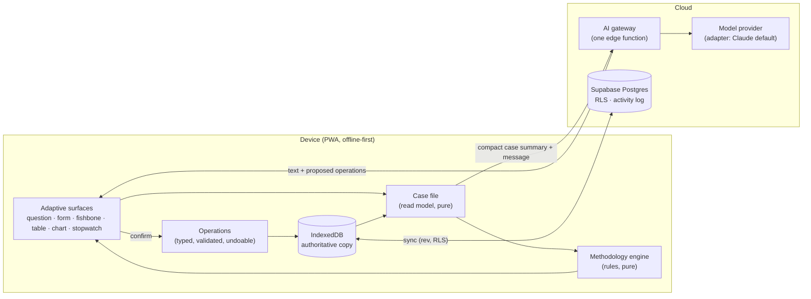

# Faultline, AI-first — the review

**Asked 18 October 2026** (Rowland's brief: *"If I were designing Faultline
today, knowing what modern AI can now do, how would I want a factory manager
to solve a problem from beginning to end?"*). Stages 1–6 of the brief: audit,
vision, gaps, architecture, roadmap, review. **Nothing here is built yet.** No
code was changed to write it. It is for review before any structural change.

---

## The answer in one page

**Faultline is not a traditional app waiting for AI.** It already has most of
the hard parts an AI-first product needs and most products lack: deterministic
manufacturing arithmetic (capacity, losses, SMED, sampling, capability, value
stream), figures that carry their sources and confidence, evidence grades on
every cause (measured · counted · observed · reported), causes that are
suspected, confirmed or ruled out, before → after on the same number, a check
that keeps the gain, an offline-first record that syncs, role-based access the
database enforces, and three AI features that already follow the right rule —
*the model proposes, the person decides, and the model computes nothing*.

**What it lacks is the front door and the connective tissue.** Today a manager
must know which tool answers which question, open it, and carry what they
learned from one screen to the next. The intelligence is in the pieces; the
investigation lives in the manager's head.

**The recommendation is to evolve, not rewrite.** Add five things around what
exists:

1. **A case file** — one read model per problem that assembles what is known,
   calculated, suspected and missing from the records already there.
2. **A methodology engine** — explicit rules that say what a good problem
   statement, a confirmed root cause and a held improvement need, and what to
   do next.
3. **An operations layer** — a small typed set of things the assistant may
   *propose* (record a cause, plan a study, raise an action), each validated,
   permission-checked, previewed and undoable, run by the app's own code.
4. **One AI gateway** — one server endpoint, one data policy, one budget,
   provider-independent, with the app working fully when it is off.
5. **An activity log** — who did what, when, and whether it began as a
   suggestion.

**The first release** is small and uses only what exists: *describe the
problem on a line in a sentence (typed or spoken) → Faultline returns a
structured problem statement, what the line's own data already says (each
figure labelled and sourced), what is not known, and the next two or three
things to do, each opening an existing tool — then opens the 6M problem with
its baseline when the manager confirms.* No new database tables are needed for
it.

---

## Stage 1 — What Faultline is today (the audit)

### Stack and shape

| | |
|---|---|
| Client | React 18 + TypeScript + Vite, a PWA (installable, offline-first). Hash router, own hooks, no state library. |
| Local store | IndexedDB (v20, 54 object stores incl. indexes), the device's working copy. |
| Cloud | Supabase: Postgres with row-level security, auth, storage (photos, video), three edge functions (`ask`, `remind`, `share`), pg_cron. |
| Sync | Own engine (`src/cloud/sync.ts`): optimistic concurrency by row revision, field-level merge, tombstones, retry, a client's rows never pushed. Proved by a two-device harness. |
| Hosting | Vercel builds `main`; two server routes (`api/voice.ts`, `api/wording.ts`). |
| Paper | jsPDF with an own layout engine (`src/lib/report/` — blocks that measure themselves); about 35 report/PDF modules; an XLSX export. |
| Size | 461 source files, ~107,000 lines (excluding tests); 63 screens, 105 UI parts, 178 logic modules. |
| Proof | ~1,830 unit tests; 25 browser acceptance scripts; smoke over 136 screens; report stress at three sizes and 40 random jobs; the page inventory; the full gate takes ~30 min. |

### The records (20 synced kinds)

| Real thing | Record | Notes |
|---|---|---|
| A production line | `workspaces` | Your factory: name, type, floor order, shifts, crew, rates, margin, machines in flow order |
| A job (a change) | `projects` | method: stage gate (`commissioning`), 6M (`board`) or lever tree |
| A job's line | `pace_ppm` | the job's view of a factory line (Stage 4 folds it into the line) |
| A machine | `commission_assets` | on a line, optionally brought in by a job |
| A stage, test, fix, step | `tests` | the stage gate's gates, proving tests, fixes; performance runs |
| A part, a problem found, a status said | `test_items` | lines on a stage; problems found on a job |
| A problem (register) | `snags` | every line and job; priority, owner, due, journey, photo marked |
| A 6M problem | `cases` | the head of the fish: baseline, target, causes on six bones with whys, grade and status, hold check |
| An action / countermeasure | `pace_todos` | what, who, due, state; on the 6M board |
| A win | `pace_wins` | |
| A lever-tree node | `tree_nodes` | |
| A timed stop | `observations` | the stopwatch; category, reason, machine, shift, media |
| A filmed walk, a marked frame | `segments`, `snag_assets` | |
| A measure's target, a reading | `targets`, `readings` | before → after on the same number |
| A material, a program | `materials`, `programs` | |
| A product's line standard / capacity | `standards` | the map, Line capacity, SMED's standard changeover |
| One use of a tool | `studies` | time study, line balance, capability, value stream, SMED, work sampling, loss count |

### The three methods and the tools

- **Stage gate** — new equipment: Install · Set up · Programs · Commission ·
  Hand over, the plan (Gantt), the day, Needs you, problems, materials, and
  the commissioning report, cards, one-page status and full report.
- **6M** — a running line: the gap → the problem (from the Pareto, the
  constraint, the gap or something seen) → causes on six bones, each graded
  and drilled with five whys → countermeasures → proof on the same number →
  holding. The fishbone fills itself from the Pareto, the walk, the standard,
  the line balance, a loss count and work sampling.
- **Lever tree** — one outcome worked down to what has to be true.
- **Tools, used inside a change or on a line alone:** the stopwatch and
  Pareto, the filmed walk, Line standard, Line capacity, Line balance, All
  together, capability, value stream, SMED, work sampling, the loss count,
  the problems register, programs, materials, measures and readings, notes
  with reminders.
- **Places above the work:** the control room (every line and job, critical,
  late, who owes what, this week), Your factory, a line's own page (Stage 3:
  products ready or not, the line report).

### Access

Supabase auth; an app invite lets a person start jobs; a job invite gives one
of three levels — **owner** (everything), **team** (does the work; what was
agreed and deleting stay with the owner), **client** (reads, takes reports).
The database enforces it (restrictive policies, a trigger keeping agreed
fields and `deleted_at` for the owner); screens follow through
`useAccess(projectId)`.

### Intelligence already in the app

| Feature | What it does | Model | Where | Rule it follows |
|---|---|---|---|---|
| **Ask** | answers a question about a line from the line's figures | Claude (Haiku class) | Supabase edge function `ask` | only facts made by tested functions are sent, never records or names; the model computes nothing; cached; 20 a person an hour; off without a key and nothing breaks |
| **Voice** | turns a voice note into the fields of the one form the person is on | Gemini (Flash) | Vercel `api/voice.ts` | proposal only — shown beside what it would change; nothing written until confirmed |
| **Wording** | rewrites typed text more clearly | Claude, else Gemini | Vercel `api/wording.ts` | proposal only |
| **Deterministic intelligence** | what a line can make (theoretical · demonstrated · plannable), where the time went, the constraint, what changed this week, confidence, the weekly brief, recurrence, fishbone suggestions from data | none | `src/lib/intelligence`, `src/engine`, `lib/ie/*` | every figure a `Figure`: its sum in words, period, source records, confidence |

This is a strong base. The rule *"the model computes nothing; the person
decides"* is exactly the integrity line the brief asks for, and it is already
written into code.

### Technical debt and limits — essential vs optional

**Essential before an assistant can be trusted:**

1. **One thing, several records.** A job's program is the floor's line *and*
   a program record; a job's line is `pace_ppm` *and* a factory line; a
   problem can be a register problem, a problem found on a job, or a 6M case.
   The app reconciles them per page (the programs audit found pages giving
   different answers). An assistant reading three records will repeat the
   confusion. The case file (Stage 4) must read through one rule; BLUEPRINT
   Stages 4–5 fold the duplicates.
2. **The method lives in many places.** What counts as late, done, proved or
   held is decided in screen-specific readings (Needs you, verdicts, the
   programs report, the 6M checks). There is no single engine to ask *"what
   is missing and what next?"*.
3. **No audit trail.** Records carry who made them and when they changed, not
   who changed what. Accepting an AI suggestion leaves no trace that it was
   one.
4. **AI scattered and ungoverned.** Two providers, two hosts, three endpoints,
   no shared data policy, no usage accounting, no evaluation set. Voice sends
   recorded audio to Google; if that is the free Gemini tier, its terms allow
   the content to be used to improve Google's products — a policy decision,
   not a code detail.
5. **Hypothesis tests and decisions are not records.** A cause can be
   suspected, confirmed or ruled out, but not *how* it was tested, what was
   predicted, or why a decision was taken.

**Optional (worth doing, not blocking):** the "Pace" naming in ~170 files;
the lint backlog (66 warnings); some very large screens; client-only search
(no server query for cross-project learning yet); the 30-minute gate (a cost,
but also the reason changes ship safely).

### Feature inventory — where each piece goes

| Today | In the new experience | Treatment |
|---|---|---|
| Control room, Your factory, line page | Stay as the manager's overview; gain *"what Faultline would do next"* per line and job | **Retain**, add next steps |
| Problem button (photo + words), voice | The front door: *"What's wrong?"* — typed, spoken or photographed | **Adapt** into intake |
| Problems register | Where every problem lands; one tap to *"investigate"* | **Retain**, fold job problems in (Stage 5) |
| 6M job, fishbone, five whys, board, hold check | The investigation's spine for a running line | **Retain**, drive from the case file |
| Stopwatch, Pareto, filmed walk | Evidence the assistant asks for and reads | **Retain**, invoked as capabilities |
| Line capacity, line balance, loss count, SMED, sampling, capability, value stream | Tests for hypotheses, proposed with a reason | **Retain**, invoked as capabilities |
| Measures, readings, before → after | Baseline and verification | **Retain**, tie to the case file |
| Stage gate (Install … Hand over), Programs, Materials | Unchanged method for new equipment; the assistant reads its state for Needs you and the day | **Retain**; assistant later |
| Lever tree | Unchanged | **Retain** |
| Ask, voice, wording | Merged into one assistant behind one gateway | **Consolidate** |
| Reports and cards | Generated from the case file; the story of the investigation | **Retain**, add the investigation report |
| The rail's long Tools list | One *Tools* door; most people arrive at a tool from a next step | **Retire from main navigation** (kept, one tap away) |
| Studies lists per tool | Reached from the line or the case file | **Retire from main navigation** |

---

## Stage 2 — The experience (a factory manager's view)

### Principles

- **Start with the problem, not the tool.** The first box is *"What's wrong?"*.
- **Faultline does the structuring; the person does the judging.** It drafts,
  connects, checks and reminds; the person confirms, corrects, decides.
- **Every statement says what it stands on** — known, calculated, hypothesis,
  inferred, unknown — and where it came from.
- **The right surface for the moment.** A question when one answer unblocks
  the work; a form when several facts are needed; the fishbone, a chart or the
  stopwatch when that is the work. Chat is one surface among several.
- **Measured by people.** Faultline asks people to count, time, film and
  check; it never pretends to read a machine.
- **It works with AI off.** Every step has a form path; the assistant is an
  accelerator, never the only way in.

### One problem, start to finish

> *"Line 7 keeps missing its 60 a minute. We've added people twice and it
> hasn't moved."* — typed on the phone on Line 7's page.

**1 · Faultline reads back what it heard, and what the line already shows.**

> **The problem, as I understand it** *(draft — edit anything)*
> Line 7 makes fewer than 60 packs a minute on Maris Piper 2 kg. Staffing was
> raised twice; output did not rise.
>
> **What the line's own records say**
> - *Calculated* — the last 6 counted shifts made 41–47 a minute (median 44),
>   against 60. *From 6 loss counts, 7–16 Oct · confidence fair.*
> - *Calculated* — Line capacity says the **Packer** limits the line at 44 a
>   minute; the Basketer, where the people were added, has 11 a minute to
>   spare. *From Line capacity, Maris Piper 2 kg, last changed 12 Oct.*
> - *Inferred* — so people added at the Basketer could not raise output. *Test
>   it before acting on it.*
> - *Unknown* — when the staffing changed, and whether the Packer's speed in
>   Line capacity was timed or typed (it says typed).
>
> **Two questions** — When were people added? Has anyone timed the Packer?

The manager answers by voice: *"Two weeks ago, and again Monday. No."*

**2 · The problem is opened, with its baseline.** One card — *Open this
problem?* — shows the 6M problem Faultline will create: the statement, the
baseline (44 a minute, calculated, sourced), the target (60, from Your
factory), the line, the product. One tap. The project exists; nothing was
typed twice.

**3 · An investigation plan, proposed — each step a tool that exists.**

| Hypothesis | Test | Tool | Why first |
|---|---|---|---|
| The Packer runs below its plate speed | time the Packer for a shift | loss count at the Packer's speed | it is the constraint; minutes there are output |
| Short stops on the Packer | time its stops for a week | stopwatch → Pareto | the loss count's "slow running and short stops" band |
| Changeovers eat the shift | time the next changeover | SMED | 3 a shift on Line 7 |
| The extra people are waiting | sample what people do | work sampling | tests the staffing story directly |

The manager drops changeovers ("only one today") and accepts the rest. Each
becomes a planned study with a person and a day.

**4 · Evidence arrives, and the case file updates itself.**

- Loss count, Tuesday: 9 min slow running and short stops on the Packer;
  45 a minute made. *Known (counted) and calculated.*
- Stops, a week: misfeeds on the Packer are 38% of the minutes lost. *Known
  (measured), 41 stops.*
- Work sampling: Op 2 waiting 31% (±7 points, 160 taps). The staffing
  hypothesis is marked **disproved** — and stays on the fishbone, struck
  through, with its evidence. *That is a finding, not a deletion.*

Faultline flags a contradiction it can prove: *"Line capacity has the Packer
at 44 typed; the loss count timed it at 47 running. Update Line capacity?"*

**5 · Root cause.** On the Machine bone, *misfeeds on the Packer* is
confirmed (measured). The whys are drilled with the operator on the phone;
each why carries its grade. Faultline objects once: *"The third why is
reported only — can it be seen? A filmed minute of the infeed would make it
observed."*

**6 · Countermeasures and actions.** Two are proposed from the root cause;
the manager rewrites one and adds a third. Each becomes an action with an
owner and a day, on the board, in Needs you and the control room.

**7 · Verification.** Two weeks on, six counted shifts: median 53 a minute.
*Calculated, confidence fair.* Faultline says plainly: *"Better than the
baseline of 44 on every shift; 7 short of 60. The target is not met."* No
"success" until the number says so.

**8 · Holding.** A check is proposed — *the Packer's misfeeds, every 7 days,
Lee* — and chased when missed (the reminders exist).

**9 · Learning.** Closing writes the investigation's story (the report) and
tags it: line, machine, loss type, cause, countermeasures, held or not. Next
time anyone describes a Packer problem, Faultline says *"Line 7 had misfeeds
on its Packer in October; the infeed guide held for 8 weeks."*

### What is different from today

| Today | Then |
|---|---|
| The manager decides to make a 6M job, picks the line, types the problem, opens Line capacity, the Pareto, the fishbone, each separately | One sentence; Faultline opens the job with its baseline and a plan |
| The baseline is typed or found | The baseline is calculated from what was counted, with its source |
| The fishbone fills from data once opened | The fishbone is the plan: each cause has a test, a status and evidence |
| A ruled-out cause just changes state | A disproved hypothesis keeps its test and evidence; dead ends are findings |
| "Is it working?" is read off a chart | Faultline says better / not yet / not held, in words, with confidence |
| Each tool's page is a destination | Tools are capabilities the investigation calls, still one tap away |

### Devices

- **Phone, on the floor:** intake by voice or photo, answers to one question
  at a time, the stopwatch, sampling taps, a filmed minute. Big targets, one
  hand, works offline (the assistant waits for signal; capture never does).
- **Tablet, at the line:** the case file — fishbone, evidence table, the next
  step — for the team stand-up.
- **Desk:** review, reports, the control room across lines.

---

## Stage 3 — Gaps, stage by stage

| Stage of improvement | Today | Gap | Reuse / adapt / new |
|---|---|---|---|
| 1 Recognise and describe | Problem button, voice into a form, register | No language → structure; no single front door | **Adapt** voice + register into intake |
| 2 Define, baseline | 6M baseline from stops; measures and readings; loss counts | No problem-statement quality check (what · where · when · how much · since when); baseline picked by hand | **New** rules in the methodology engine; **reuse** figures |
| 3 Observe, gather evidence | Stopwatch, walk, studies, frames — strong | Evidence is not linked to the question it answers | **Adapt**: a study/test carries the hypothesis it tests |
| 4 Investigate causes | Fishbone, six bones, five whys, suggestions from data | Suggestions are per source, not prioritised by the gap | **Adapt** suggestions into the plan |
| 5 Test and verify root causes | Grade + suspected/confirmed/ruled out | No record of the test: prediction, method, result | **New**: a test on a cause (small, on the existing cause) |
| 6 Countermeasures | Board actions from causes and studies | Not tied to the cause they answer everywhere | **Adapt**: link action → cause |
| 7 Assign and manage | Owner, due, state, Needs you, control room, reminders | — | **Retain** |
| 8 Measure the outcome | Before → after on the same number, confidence | No verdict in words against the target with noise | **Adapt**: a deterministic verdict |
| 9 Sustain | Hold check, missed check chased | Not proposed; no "held for N weeks" | **Adapt** |
| 10 Capture learning | Wins, reports | No search or tags across closed problems | **New**: tags + search, later descriptive analysis |

Also missing across all stages: **an activity log**, **decisions with their
reasons**, and **one assistant** with a data policy.

---

## Stage 4 — Architecture (the smallest that delivers it)

### A · Reasoning and language (the model)

- **Use an existing model; do not train one.** Faultline's advantage is the
  method, the evidence and the data, not a network of its own.
- **Two tiers.** A small, fast model for structuring (intake, voice to fields,
  wording) — most calls; a stronger model only when the person asks for
  reasoning over a case file. Both through one adapter
  (`understand(task, input, schema) → { data, usage }`), so the provider is a
  configuration choice. Claude is the default (already integrated, SDK in
  the app); the Gemini adapter stays for audio until voice moves to a provider
  under no-training terms.
- **Prompts are code:** versioned in the repo, tested against a small
  evaluation set of real (anonymised) problems, so a model change is a
  measured change.

### B · Project memory (the app is the record)

- The **database is the memory**; the conversation is disposable. Every
  accepted step becomes a record; every proposal not accepted is forgotten.
- **The case file** (`lib/caseFile`, pure) assembles, for one problem: the
  statement and its completeness; the baseline and target as `Figure`s; the
  evidence (stops, counts, studies, readings, frames, problems) each with its
  grade and source; the causes with status and tests; actions; results;
  hold checks; and the unknowns the engine finds. It is what the screen draws
  *and* what the model is sent.
- **Context is small by design.** The model gets a compact summary (typically
  1–3k tokens): headlines, figures with ids, statuses, open questions. Detail
  is fetched by id through read-only operations when needed. No vector
  database until cross-project search proves it is needed; Postgres full-text
  search first.

### C · Methodology engine

- **Explicit rules, per method** (`lib/method/sixm` first), over the case
  file: *a defined problem* has what, where, when, how much and a baseline; *a
  root cause* needs a confirmed cause with evidence at least observed and a
  why chain that reads back; *success* needs the same measure after, over
  enough periods, beyond the baseline's spread; *held* needs its checks met.
- **Output:** checks (met / not met / why), contradictions it can prove, and
  the next steps ranked by what unblocks the investigation — each pointing at
  an operation or a tool. The control room's Needs you becomes one consumer.
- **Not a rigid sequence.** The engine says what is missing, not what order
  to do things in; the person can skip, defer or record *"not needed, because
  …"* — that reason is kept.
- It **consolidates** rules that today live in screens (verdicts, Needs you,
  the 6M checks), one method at a time, with the existing acceptance scripts
  proving nothing moved.

### D · Operations (the only way the assistant changes anything)

- A **registry** of a dozen or so operations to start: `draftProblem`,
  `openProblem`, `addEvidenceNote`, `addCause`, `setCauseStatus`, `addWhy`,
  `planStudy`, `recordTest`, `proposeAction`, `recordReading`,
  `proposeHoldCheck`, `recordDecision`; plus read-only `getRecord`,
  `listEvidence`.
- Each has a **JSON schema** (sent to the model as a tool), a **validator**,
  a **permission check** through the existing `can`, a **preview** (what it
  would change, as a card) and an **apply** that calls the existing `db`
  functions and returns an **Undo** (the app already has `offerUndo`).
- **The model only proposes.** The server checks the schema; the device checks
  it again against the current records and the person's access; the person
  confirms; the app applies. Consequential changes always ask; small,
  reversible ones (a note) can be one tap.

### E · Evidence and reasoning integrity

Every statement in the case file carries a **basis**:

| Basis | Comes from | Example |
|---|---|---|
| **Known** | a record a person made — a stop, a count, a reading, an observation by a named person | "41 stops, 7–13 Oct" |
| **Calculated** | a tested function over known records (`Figure`, with sources and confidence) | "median 44 a minute, 6 shifts, fair" |
| **Hypothesis** | a cause suspected, a test planned | "short stops on the Packer" |
| **Inferred** | a conclusion drawn by the engine or the model, not yet tested | "added people could not raise output" |
| **Unknown** | a required fact the engine found missing | "when staffing changed" |

Rules: **the model cannot raise a basis** — only a person accepting it with a
linked source can; inferred text is drawn differently and never stored as
fact; calculations, totals, deadlines and permissions are always the app's
code; contradictions are flagged only when a rule can show them; a disproved
hypothesis keeps its test and evidence.

The existing grades map straight on: measured and counted → known (or
calculated when summed); observed → known, with a name; reported → known
that it was said, weak as evidence; suspected → hypothesis; ruled out →
disproved, kept.

### F · Learning from completed problems

Start with **structure, search and counts**: tag on close (line, machine,
loss type, cause, countermeasure, held or not); full-text search over
problems, causes and actions; *"similar problems"* by tags; simple counts
(*"countermeasures on misfeeds held 4 of 5 times"*). **Predictive models only
when there are enough closed, tagged problems to test them on** — not before.

### Data handling, cost and failure

- **A written data policy first:** what may be sent (problem text, line and
  machine names, computed figures), what is never sent by default (people's
  names, photos, video, customer names), providers only under terms that do
  not train on the data and with minimal retention, a visible *"assistant on"*
  switch per factory, and where processing happens (for a UK factory, which
  regions).
- **Cost:** the small model by default, short contexts, caching, a per-person
  rate limit (Ask has one), a monthly budget per factory, usage counted from
  day one.
- **Failure:** timeouts and outages fall back to the form path; the device
  never waits on the model to capture anything; a proposal that fails
  validation is dropped and said so.
- **Not built:** an agent framework, autonomous loops, a vector database, a
  fine-tuned model, a new backend. Each would need a requirement this plan
  does not yet have.

---

## Stage 5 — Roadmap

Each phase ships live on its own, through the gate, as now.

| Phase | The user gets | Built | Depends on | Accepted when | Effort · risk · running cost |
|---|---|---|---|---|---|
| **0 · Ground** | Nothing visible; safety | Data policy (written, agreed); one AI gateway with provider adapters, budget, usage log; Ask, voice and wording moved behind it unchanged; activity log table | Rowland's decisions on provider and data | Ask/voice/wording behave as today; usage counted; turning the assistant off changes nothing else | S–M · low · as today |
| **1 · Describe it** *(first release)* | A sentence on a line becomes a problem statement, what the data already says, what is unknown, 2–3 next steps; one tap opens the 6M problem with its baseline | Intake surface on the line page and control room; case file v1 (read model over existing records); 6M rules v1 (statement + baseline + next steps); operations `draftProblem`, `openProblem`; small-model structuring | Phase 0 | From a typed or spoken sentence on a seeded line: the statement drafted, every figure labelled and sourced, the unknowns listed, the problem opened with its baseline in ≤ 3 taps; with the assistant off, the same through a form; nothing written without confirmation; an acceptance script | M · medium · low (small model, short context) |
| **2 · The case file** | One page per problem: the plan (hypotheses with tests), evidence by basis, contradictions, the next step drawing the right surface | Case file page; hypothesis tests on causes (prediction · method · result · disproved kept); evidence ↔ question links; engine v2; operations for causes, tests, studies | Phase 1 | A disproved hypothesis stays with its evidence; a study planned from a hypothesis reports back to it; a provable contradiction flagged; no basis raised by the model | M–L · medium · low |
| **3 · The assistant across the work** | Talk or type anywhere in an investigation; proposals land as cards; actions and decisions recorded with reasons | Operations for actions, readings, decisions, hold checks; voice into the case file; stronger model on request | Phase 2 | Every accepted proposal in the activity log as such; permissions refused for team/client as the database would | M · medium · medium (budgeted) |
| **4 · Verify and hold** | *Better / not yet / met / held* said in words against the baseline and target, with confidence; hold checks proposed and chased | Verdict rules; hold-check proposals; closing report from the case file | Phase 2 | No "success" while the after-figure is within noise of the baseline or below target; held only after its checks | S–M · low · none |
| **5 · Learning** | Similar past problems and what held, when a new one is described | Tags on close; Postgres full-text search; descriptive counts | Phases 1–4, a body of closed problems | Search finds a past problem by machine and loss type; counts reproducible by hand | S–M · low · none |
| Alongside | Cleaner foundations | BLUEPRINT Stages 4–5 (one record per thing: job lines, problems) | — | As in the blueprint | as planned |

**Why Phase 1 first:** it is the whole idea in miniature — start from the
problem, the data speaks first, honesty about what is known, the existing
method and tools do the rest — and it needs no new tables, touches no
existing flow, and can be switched off.

---

## Stage 6 — For review before anything is built

Decisions for Rowland:

1. **The data policy** — what may leave the factory, to which provider, under
   which terms; and whether voice moves off the free Gemini tier.
2. **The provider** — Claude as default through one adapter (recommended), or
   another; and a monthly budget.
3. **The first method** — 6M first (recommended: a running line is where a
   manager starts from a symptom); stage gate's assistant later (its work is
   planned, not investigated).
4. **The front door** — on a line's page and the control room (recommended),
   or a single global "What's wrong?" button.
5. **Order** — Phase 1 before or after BLUEPRINT Stage 5 (one record for
   problems). Recommended: Phase 0 and 1 first (they read through one rule and
   do not need the fold); Stage 5 before Phase 3.
6. **Scope** — this stays a tool for a consultant and a small factory team
   (17 October: *"a tool for a one man consultant"*); nothing here adds
   organisation-level administration.

The full audit behind this page is the repository itself: `docs/BLUEPRINT.md`
(the map), `docs/upgrade-plan.md` (the intelligence layer and its rule),
`docs/SIXM.md` (the 6M method), `docs/TOOLKIT.md` (the tools' honesty rules),
and `docs/PROGRAMS-AUDIT.md` (what two records for one thing does to a page).
